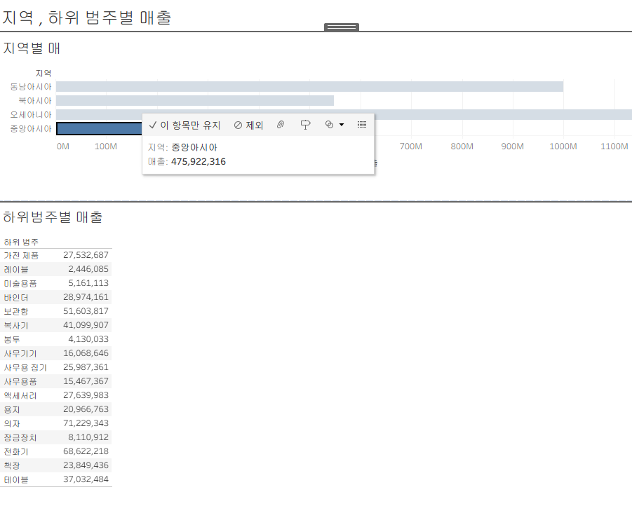

# 📊 Tableau 6주차 정규과제

이번 주는 지금까지 만든 시트들을 하나의 화면으로 엮어 **미니 대시보드**를 제작합니다. 또한 7주차 최종 프로젝트를 가볍게 준비하기 위해, 사용할 데이터와 분석 질문을 미리 정리합니다.

> ✅ **수행 인증샷은 필수입니다.**  
대시보드 전체 화면 캡처와, 가능하다면 Tableau Public 링크를 함께 첨부해주세요.

---

## 📌 1. 이번 주 학습 범위

### 🎬 DKBMC Tableau 강의

- 48강. 워크시트 서식(2)
- 49강. 대시보드 패널
- 50강. 대시보드 구성방식
- 51강. 대시보드 컨테이너
- 52강. 레이아웃 패널
- 53강. 필터 동작
- 54강. 대시보드 하이라이터 동작
- 55강. 대시보드 URL
- 56강. 대시보드 시트에 이동 동작
- 57강. 매개변수 변경 동작

> 💡 이번 주는 강의 요약보다 직접 배치하고 눌러보는 시간이 더 중요합니다.

---

## 🗺️ 2. 주차별 로드맵

| 주차 | 학습 범위 | 학습 주제 | 완료 여부 |
| --- | --- | --- | --- |
| 1주차 | 1강-8강 | 데이터 연결, 관계/조인/유니온, 라이브/추출 | ✅ |
| 2주차 | 9강-17강 | 데이터 형식, 차원/측정값, 기본 시각화 | ✅ |
| 3주차 | 18강-24강, 28강-29강 | 다양한 차트, 필터, 그룹 | ✅ |
| 4주차 | 30강-38강 | 계층, 집합, 계산된 필드, 테이블 계산 | ✅ |
| 5주차 | 39강-47강 | LOD, 매개변수, 서식 | ✅ |
| 6주차 | 48강-57강 | 대시보드, 동작, 최종 프로젝트 기획 | ✅ |
| 7주차 | 58강-66강 중 선택 | 최종 프로젝트 완성, 선택 기능 고도화 | 🍽️ |

<!-- 여기까진 그대로 둬 주세요-->

---

# 1️⃣ 🧠 핵심 개념 카드

이번 주에는 아래 개념 중 2개를 골라 개념 카드로 정리해주세요. 필요하다고 생각하면 2개보다 더 많이 정리해도 좋습니다.

> 예시 개념: 대시보드, 바둑판식/부동, 컨테이너, 레이아웃 패널, 필터 동작, 하이라이트 동작, URL 동작, 매개변수 변경 동작

## 개념 1. `대시보드`

**1. 이 개념을 한 문장으로 설명하면?**

```
여러 개의 차트를 한번에 표시 
```

**2. 언제 사용하나요?**

```
여러 시트들 중에 하나를 대시보드로 드래그 앤 드랍하면 대시보드에 시트가 자동으로 채워짐. 태블로가 지원하는 개체들 사용 가능
```

**3. 이번 실습에서 어떻게 확인했나요?**

```
왼쪽 맵 차트를 선택하고 오른쪽 분할 화면에 해당 막대 차트가 그려짐
```

**4. 헷갈린 점 또는 주의할 점은?**

```
대시보드를 해삳도에 맞게 크기 조절하고 배치할 수 있음
```

## 개념 2. `하이라이트 동작`

**1. 이 개념을 한 문장으로 설명하면?**

```
대시보드에서 데이터를 필터링하는 대신, 전체 데이터 중에 선택한 조건을 따라 데이트를 하이라이트로 구분
```

**2. 언제 사용하나요?**

```
색상으로 구분되어 있지만, 표시되는 데이터 마크의 양 때문에 모든 데이터 마크를 구별하기 어려울 때, 원하는 제품의 하위 범주를 나머지 범주와 구분하기 위해 사용. 
```

**3. 이번 실습에서 어떻게 확인했나요?**

```
대시보드 탭 -> 동작 클릭-> 하이라이트 동작 추가. 원하는 데이터를 남은 데이터와 쉽게 비교 가능
```

**4. 헷갈린 점 또는 주의할 점은?**

```
하이라이트 동작이 작동하려면, 선택 기준으로 사용하는 필드가 변경할 그래프에 포함되어 있어야 함.
데이터를 범주별로 정렬되지 않도록 하기 위해서는 적어도 마크의 도구 설명에 데이터를 포함해야 함
```

---

# 2️⃣ 🛠️ 실습 전 준비

## 📂 사용 데이터

- 미니 대시보드: `DArt-B_sample_superstore.xls`
- 최종 프로젝트 기획: 자유 데이터 또는 Superstore 사용 가능

## 📸 제출 시 포함할 것

- **핵심 개념 카드 2개**
- **미니 대시보드 캡처**
- **대시보드에 적용한 동작 설명**
- **최종 프로젝트 기획 초안**

---

# 3️⃣ 🚀 실습 확인문제

## 문제 1. Superstore 미니 대시보드 만들기 `[기본]` ✅

Superstore 데이터를 사용해 워크시트 2개 이상을 포함한 미니 대시보드를 만들어주세요.

필수 조건:

1. 워크시트 2개 이상
2. 필터 동작 또는 하이라이트 동작 1개 이상
3. 대시보드 제목 포함

```
대시보드 주제: 슈퍼스토어 지역 및 하위 범주별 매출 현황 
포함한 워크시트: 지역별 매출, 범주별 매출
적용한 동작: 필터 동작
사용한 구성 방식(바둑판식/부동): 바둑판식
캡처 이미지: 
Tableau Public 링크(선택):
```

---

## 문제 2. 최종 프로젝트 기획하기 `[기본]` ✅

7주차에 완성할 최종 프로젝트를 가볍게 기획해주세요. 프로젝트 주제가 아직 확정되지 않았다면 임시 주제로 작성해도 됩니다.

```
사용할 데이터: 서울시 공공자전거(따릉이) 대여 이력 데이터 및 서울시 기상 데이터
데이터 출처: 서울 열린데이터 광장, 기상청
분석하고 싶은 질문 1: 출퇴근 시간대에 따릉이 수요가 가장 집중되는 지역은 어디일까?
만들고 싶은 그래프 2개: 따릉이 대여소 위치별 이용량을 나타내는 맵 그래프, 요일별 이용량 추이를 날씨와 비교해 보여주는 이중 축 라인 차트
최종 대시보드에서 보여주고 싶은 핵심 메시지: 따릉이는 꽤나 유용한 교통수단으로 기능하고 있으며, 출퇴근시간에 직장인과 학생들에 의해 요긴하게 사용되고 있다.
걱정되는 점 또는 도움이 필요한 부분: 대여 데이터와 기상 데이터를 날짜 기준으로 조인할때 구조가 꼬이지 않게 처리하는 방법이 필요하다.
```

---

# 4️⃣ 📝 이번 주 회고

## 대시보드를 만들며 가장 신경 쓴 부분

```
여기에 작성해주세요.
```

## 최종 프로젝트를 위해 다음 주에 해야 할 일

```
여기에 작성해주세요.
```

<br>

### 🎉 수고하셨습니다.